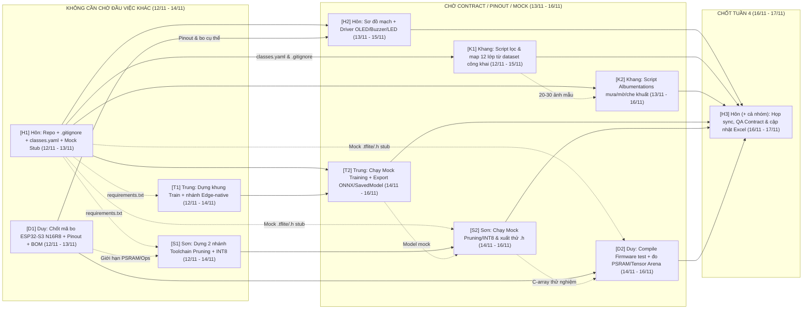

# KẾ HOẠCH THỰC HIỆN ĐỒ ÁN TUẦN 4 (11/11 – 17/11/2026)
## MÔN: TRÍ TUỆ NHÂN TẠO CHO HỆ THỐNG NHÚNG (`CE340`) — ĐỀ TÀI EDGE AI & TINYML

> **Khoảng thời gian:** Thứ Tư `11/11/2026` – Thứ Ba `17/11/2026` *(Tuần 4 — Khởi động Zero-Waiting Pipeline; khung thực thi tập trung `12/11 – 17/11/2026`)*  
> **Tài liệu tham chiếu:** [De_Cuong_Chi_Tiet_Do_An_CE340.md](./De_Cuong_Chi_Tiet_Do_An_CE340.md) | [Khao_Sat_De_Tai_Va_Phuong_An_Thiet_Ke_CE340.md](./Khao_Sat_De_Tai_Va_Phuong_An_Thiet_Ke_CE340.md) | [Ke_Hoach_Thuc_Hien_Do_An_CE340_Nhom_Hon.xlsx](./Ke_Hoach_Thuc_Hien_Do_An_CE340_Nhom_Hon.xlsx) | [README.md](./README.md)  
> **Phạm vi tài liệu:** Chỉ liệt kê các đầu việc **thuộc Đồ án CE340** của 5 thành viên trong Tuần 4 theo bảng phân công đã cập nhật (hoán đổi nhiệm vụ giữa **Vũ Văn Duy** – Nhúng & Thực nghiệm và **Hoàng Cao Sơn** – Tối ưu hóa TinyML). Mỗi đầu việc ghi rõ **Đầu vào (Inputs)**, trạng thái **Chờ người khác hoàn thành**, **Sản phẩm bàn giao** và **lưu ý kỹ thuật**.  
> **Quy ước GitHub & Contract-First:** GitHub chỉ lưu mã nguồn, `classes.yaml`, `requirements.txt`, tài liệu, ảnh preview mẫu nhỏ và file `.tflite`/`.h` gọn; **toàn bộ dataset ảnh (`images/`, `raw/`) và trọng số lớn (`.pt`, `.onnx`) phải đưa vào `.gitignore` và lưu trên Google Drive / Roboflow**.

---

## I. SƠ ĐỒ PHỤ THUỘC ĐẦU VIỆC (AI LÀM LUÔN – AI CHỜ AI?)

---

## II. MA TRẬN PHỤ THUỘC TỔNG HỢP GIỮA 5 THÀNH VIÊN

| Thành viên | MSSV | Đầu việc làm được NGAY (Không chờ ai) | Đầu việc PHẢI CHỜ người khác | Vai trò mở khóa cho người sau |
| :--- | :---: | :--- | :--- | :--- |
| **Trần Hoàng Hôn** *(Trưởng nhóm / PM, QA & Ngoại vi)* | `26410046` | `[H1]` | • `[H2]` (cần `[H1]` dựng thư mục repo + **mã bo & pinout cụ thể từ `[D1]`** trước tối `13/11`) • `[H3]` (chờ `[H2]`, `[K1]`, `[K2]`, `[T2]`, `[S2]`, `[D2]` vào `16/11–17/11`) | **`[H1]` mở khóa Zero-Waiting cho cả nhóm** — cung cấp `.gitignore`, `classes.yaml` (12 lớp chuẩn nghĩa QCVN) và *Mock Stub* trước tối `13/11`. |
| **Nguyễn Duy Khang** *(Kỹ sư Dữ liệu & Tăng cường ảnh)* | `26410055` | *(Tải trước dataset Zalo AI / Roboflow về Drive trong khi chờ `classes.yaml`)* | • `[K1]` (chờ `classes.yaml` từ `[H1]` để chốt `class_id` `0..11` trước khi chạy script gộp nhãn) • `[K2]` (chờ `[H1]` + `20–30` ảnh mẫu từ `[K1]`) | **`[K1]` & `[K2]` mở khóa** nguồn dữ liệu thật và dữ liệu thời tiết khắc nghiệt cho Tuần 5 của Trung và tập hiệu chuẩn cho Sơn. |
| **Phạm Thành Trung** *(Kỹ sư AI — Huấn luyện & Benchmark)* | `26410141` | `[T1]` *(khớp phiên bản thư viện với `[H1]`/`[S1]`)* | • `[T2]` (chờ `[T1]` của chính Trung + bộ ảnh mock từ `[H1]` hoặc subset sớm từ `[K1]`) | **`[T2]` mở khóa** 2 định dạng model trung gian (`SavedModel`/`Keras` cho nhánh TF & `ONNX` cho nhánh PyTorch) để Sơn chạy `[S2]`. |
| **Hoàng Cao Sơn** *(Kỹ sư Tối ưu hóa TinyML)* | `25730061` | `[S1]` *(khớp giới hạn bộ nhớ với `[D1]`)* | • `[S2]` (chờ `[S1]` của chính Sơn + model mock từ `[H1]` hoặc `[T2]`, kèm giới hạn `PSRAM`/`Tensor Arena` từ `[D1]`) | **`[S2]` mở khóa** file `.tflite` INT8 và mảng C-array `.h` chuẩn toán tử `tflite-micro` để Duy kiểm tra biên dịch/nạp trên `ESP32-S3`. |
| **Vũ Văn Duy** *(Kỹ sư Nhúng & Thực nghiệm)* | `26410031` | `[D1]` | • `[D2]` (chờ `[D1]` của chính Duy + file `.tflite`/`.h` stub từ `[H1]`/`[S2]`) | **`[D1]` mở khóa** mã bo chính xác + sơ đồ chân (*Pinout*, tránh `GPIO 33–37` PSRAM) cho `[H2]` của Hôn và giới hạn bộ nhớ cho `[S1]`/`[S2]` của Sơn. |

---

## III. KẾ HOẠCH CHI TIẾT TỪNG THÀNH VIÊN (11/11 – 17/11/2026)

### 1. Trần Hoàng Hôn (`26410046`) — Trưởng nhóm / PM, QA & Giao tiếp ngoại vi
*Định mức CE340 Tuần 4: ~3.0 giờ (khởi tạo khung Zero-Waiting, bảo vệ Repo Hygiene, chuẩn hóa ngoại vi & điều phối sync)*

| Mã CV & Hạn | Đầu việc Đồ án | Đầu vào (Inputs) | Chờ người khác hoàn thành? | Sản phẩm bàn giao (Deliverables) |
| :--- | :--- | :--- | :--- | :--- |
| **`[H1]`** 12/11 – 13/11 *(xong trước tối 13/11)* | Khởi tạo cấu trúc Repo, cập nhật `.gitignore`, chốt `classes.yaml` (12 lớp) & tạo *Mock Stub* | • Danh mục 12 biển báo tại Mục I.5 của [De_Cuong_Chi_Tiet_Do_An_CE340.md](./De_Cuong_Chi_Tiet_Do_An_CE340.md#L138-L142) • File [.gitignore](./.gitignore) hiện có | **Không cần chờ ai (Làm ngay).** *Lưu ý kỹ thuật:* (1) Cập nhật `.gitignore` chặn `raw/`, `images/`, `*.pt`, `*.onnx`, `runs/`, `.venv/` để không vỡ repo GitHub; (2) Trong `classes.yaml`, **ghi rõ cả tên ý nghĩa tiếng Việt lẫn mã QCVN 41:2019 thực tế** (`P.123a`/`P.123b` cho Cấm rẽ trái/phải, `P.104` cho Cấm xe mô tô — tránh Khang lấy nhầm `P.103a` Cấm ô tô); (3) *Mock Stub* chỉ cần `5` ảnh mẫu + `1` model Keras tối giản vài KB sinh bằng script để thông pipeline nhanh. | • 6 thư mục trên GitHub: `01_dataset/`, `02_augmentation/`, `03_models_benchmark/`, `04_tinyml_optimization/`, `05_firmware_esp32s3/`, `06_reports_slides/` + `requirements.txt` + `.gitignore` chuẩn. • `01_dataset/classes.yaml` + `5` ảnh mẫu + `1` file `.tflite`/`.h` stub tối giản. |
| **`[H2]`** 13/11 – 15/11 | Thiết kế sơ đồ đấu nối phần cứng & viết module driver test ngoại vi ghi-đông (`OLED`, `Buzzer`, `LED`) | • Khối Giao Diện Cảnh Báo tại Mục III của [Khao_Sat_De_Tai_Va_Phuong_An_Thiet_Ke_CE340.md](./Khao_Sat_De_Tai_Va_Phuong_An_Thiet_Ke_CE340.md#L131-L137) • **Mã bo mạch cụ thể & bảng Pinout từ `[D1]`** | **Chờ `[H1]`** (thư mục `05_firmware_esp32s3/`) và **BẮT BUỘC CHỜ `[D1]` chốt đúng mã bo `ESP32-S3-CAM` trước tối `13/11`** (vì mỗi bo như *Freenove S3-CAM*, *Seeed XIAO S3 Sense* hay *ESP-EYE* dùng bộ chân camera `OV2640` khác nhau và phải né `GPIO 33–37` của Octal PSRAM). | • Sơ đồ đấu nối `05_firmware_esp32s3/wiring_diagram.md` (chốt chân `SDA/SCL` `OLED I2C`, `PWM` `Buzzer 5V`, `LED`, nguồn `5V`). • Module `05_firmware_esp32s3/peripherals_test/` hiển thị icon biển báo + còi bíp theo `class_id` giả lập (chạy kiểm tra trên Wokwi hoặc mạch thật). |
| **`[H3]`** 16/11 – 17/11 | Điều phối họp sync cuối Tuần 4, kiểm tra chéo (QA) & cập nhật tiến độ | • Toàn bộ sản phẩm `[H2]`, `[K1]`, `[K2]`, `[T2]`, `[S2]`, `[D2]` • [Ke_Hoach_Thuc_Hien_Do_An_CE340_Nhom_Hon.xlsx](./Ke_Hoach_Thuc_Hien_Do_An_CE340_Nhom_Hon.xlsx) | **Chờ tất cả đầu việc Tuần 4 hoàn thành** để rà soát khớp *Contract*: `classes.yaml` ↔ Export TF/ONNX ↔ INT8 `.tflite`/`.h` ↔ Firmware `ESP32-S3` (hoặc quyết định kích thước input tối ưu `160x160`/`192x192` vs `320x320` nếu chạy MCU vs Pi). | • Biên bản chốt kỹ thuật `06_reports_slides/week4_sync_notes.md` (chốt rõ kiến trúc model & input resolution cho Tuần 5). • Nhánh `main` GitHub sạch (không chứa dataset/weights nặng) + cập nhật `%` Tuần 4 trong [Ke_Hoach_Thuc_Hien_Do_An_CE340_Nhom_Hon.xlsx](./Ke_Hoach_Thuc_Hien_Do_An_CE340_Nhom_Hon.xlsx). |

---

### 2. Nguyễn Duy Khang (`26410055`) — Kỹ sư Dữ liệu & Tăng cường ảnh
*Định mức CE340 Tuần 4: ~3.0 giờ | Dùng script tự động ánh xạ từ dataset công khai để kịp tiến độ 5 ngày*

| Mã CV & Hạn | Đầu việc Đồ án | Đầu vào (Inputs) | Chờ người khác hoàn thành? | Sản phẩm bàn giao (Deliverables) |
| :--- | :--- | :--- | :--- | :--- |
| **`[K1]`** 12/11 – 15/11 | Thu thập & chạy script chuẩn hóa nhãn 12 lớp biển báo Việt Nam từ dữ liệu công khai | • Nguồn dữ liệu có sẵn nhãn (*Zalo AI Challenge Traffic Sign*, *VNTS*, *Roboflow Universe*) + clip tự quay đường phố TP.HCM • `01_dataset/classes.yaml` từ `[H1]` | **Tải dataset nguồn ngay; chờ `classes.yaml` từ `[H1]` trước khi xuất `labels/*.txt`.** *Lưu ý kỹ thuật:* (1) Không gán nhãn tay `500–1,000` ảnh từ đầu (quá định mức 3h) — viết script Python lọc & ánh xạ trực tiếp nhãn từ tập công khai theo **ý nghĩa biển báo**, kiểm tra lại mã QCVN 41:2019 (`P.123a/b` vs `P.103a/b`, `P.104` vs `P.111a`); (2) Chia `Train / Val / Test (70 / 20 / 10)` theo **nhóm phiên quay / nguồn (group split)** để chống leak frame; (3) Lưu ảnh lên Drive/Roboflow, không push dataset lên GitHub. | • Script `01_dataset/remap_and_split.py` + `01_dataset/data.yaml` + báo cáo phân bố lớp `01_dataset/dataset_summary.md` (đạt tối thiểu `500–1,000` ảnh sạch 12 lớp trên Drive, sẵn sàng cho Tuần 5). |
| **`[K2]`** 13/11 – 16/11 | Xây dựng & kiểm thử script `Albumentations` tăng cường dữ liệu thời tiết phức tạp | • Yêu cầu kịch bản tại Nội dung 2 & Mục I.5 Đề cương: mưa đọng ống kính, mờ chuyển động (`30–50 km/h`), che khuất ($< 40\%$), thiếu sáng ban đêm • Subset `20–30` ảnh có nhãn từ `[K1]` (hoặc mock `[H1]`) | **Viết script ngay được; chạy test xuất ảnh mẫu sau khi có `classes.yaml` (`[H1]`) và `20–30` ảnh mẫu từ `[K1]`.** *Lưu ý kỹ thuật:* Bắt buộc cấu hình `A.BboxParams(format='yolo', label_fields=['class_labels'], min_visibility=0.4)` và kiểm tra trực quan `20` ảnh đầu ra để bảo đảm bounding box không bị lệch hoặc mất nhãn. | • Script `02_augmentation/augment_weather.py` (`RandomRain`, `MotionBlur`, `CoarseDropout`, `RandomBrightnessContrast`). • Thư mục mẫu `02_augmentation/preview_samples/` chứa `20` ảnh nhẹ đã vẽ bounding box kiểm chứng. |

---

### 3. Phạm Thành Trung (`26410141`) — Kỹ sư AI (Huấn luyện & Benchmark)
*Định mức CE340 Tuần 4: ~2.5 giờ | Dựng khung train 3 mô hình benchmark + nhánh Edge-native tương thích phần cứng thật*

| Mã CV & Hạn | Đầu việc Đồ án | Đầu vào (Inputs) | Chờ người khác hoàn thành? | Sản phẩm bàn giao (Deliverables) |
| :--- | :--- | :--- | :--- | :--- |
| **`[T1]`** 12/11 – 14/11 | Thiết lập môi trường GPU & dựng khung huấn luyện 3 kiến trúc (`YOLOv8n`, `YOLOv5-tiny`, `MobileNetV2-SSD`) + cấu hình input cho Edge | • Danh sách 3 mô hình tại Nội dung 3 của [De_Cuong_Chi_Tiet_Do_An_CE340.md](./De_Cuong_Chi_Tiet_Do_An_CE340.md#L122-L125) • `requirements.txt` từ `[H1]` (chốt phiên bản `torch`, `ultralytics`, `tensorflow` khớp với `[S1]`) | **Không cần chờ ai viết khung code; chốt phiên bản thư viện trong `requirements.txt` cùng `[H1]` & `[S1]`.** *Lưu ý kỹ thuật quan trọng:* `YOLOv8n` ở `320x320`/`416x416` khó đạt `10–15 FPS` trên MCU `ESP32-S3`; do đó khung cấu hình cần **hỗ trợ tham số `--imgsz` linh hoạt (`160`, `192`, `320`)** và ưu tiên kiểm tra thêm biến thể siêu nhẹ (`MobileNetV2-SSD 0.35x` hoặc `YOLO-Fastest`/`PicoDet`) để có phương án chạy thật trên `ESP32-S3` (bên cạnh benchmark so sánh trên Colab/Pi). | • Script khung `03_models_benchmark/train_baseline.py` (hỗ trợ cấu hình kích thước ảnh `160–320px` và chuyển đổi kiến trúc giữa nhánh `PyTorch/YOLO` và nhánh `TF/MobileNetV2-SSD`). |
| **`[T2]`** 14/11 – 16/11 | Chạy thử **Mock Training Pipeline**, chuẩn hóa hàm Benchmark & kiểm tra Export cho 2 luồng TinyML | • Khung code từ `[T1]` • Bộ *Mock Stub* (`[H1]`) hoặc subset `20–30` ảnh (`[K1]`) | **Chờ `[T1]` của chính Trung + *Mock Stub* từ `[H1]`.** *Lưu ý kỹ thuật:* Chạy smoke-test `2–5 epochs` để sinh đủ `Precision`, `Recall`, `F1-Score`, `mAP@0.5`, `Confusion Matrix` và **export thử cả 2 định dạng sạch**: `SavedModel/Keras` (nhánh TF để Sơn dùng `tfmot`) và `ONNX` (nhánh PyTorch), kiểm tra trước không có lỗi ops lạ. | • Script `03_models_benchmark/evaluate_benchmark.py`. • Log smoke-test & model mock FP32 (lưu `SavedModel`/`.onnx` gọn tại Drive hoặc mock nhỏ tại `03_models_benchmark/mock_outputs/`), bàn giao cho Sơn chạy `[S2]`. |

---

### 4. Hoàng Cao Sơn (`25730061`) — Kỹ sư Tối ưu hóa (TinyML)
*Định mức CE340 Tuần 4: ~2.5–3.0 giờ | Mới nhận chuyển giao TinyML: tách đúng 2 toolchain Pruning + Full INT8 tương thích `ESP32-S3`*

| Mã CV & Hạn | Đầu việc Đồ án | Đầu vào (Inputs) | Chờ người khác hoàn thành? | Sản phẩm bàn giao (Deliverables) |
| :--- | :--- | :--- | :--- | :--- |
| **`[S1]`** 12/11 – 14/11 | Nghiên cứu & thiết lập **2 luồng toolchain** nén TinyML (`Pruning` + `INT8`) tương thích `tflite-micro` trên `ESP32-S3` | • Nội dung 4 & Mục I.6 Đề cương (`TFLite`, `TFLM`, `ONNX`) • Giới hạn Flash/PSRAM và `kTensorArenaSize` từ `[D1]` | **Không cần chờ ai dựng môi trường Python; đối chiếu giới hạn bộ nhớ `ESP32-S3` với `[D1]` của Duy.** *Lưu ý kỹ thuật (tránh đứt toolchain):* **`tfmot` chỉ prune được trên model Keras/TF gốc**, không chạy trên model đã convert từ PyTorch sang ONNX. Do đó phải tách 2 luồng rõ ràng: 1) *Luồng TF (`MobileNetV2-SSD`)*: `tfmot` Pruning $\rightarrow$ `TFLiteConverter INT8`. 2) *Luồng PyTorch (`YOLOv8n`/`YOLOv5`)*: `torch.nn.utils.prune` (trên PyTorch) $\rightarrow$ `ONNX` $\rightarrow$ `onnx2tf` $\rightarrow$ `TFLite INT8`. Đồng thời kiểm tra bảng ops hỗ trợ của `tflite-micro` (và cân nhắc `ESP-DL` nếu `YOLOv8` DFL ops bị kẹt). | • Tài liệu `04_tinyml_optimization/tinyml_toolchain_notes.md` chốt rõ 2 luồng Pruning/Quantization, bảng kiểm ops hợp lệ cho `tflite-micro` và ngân sách kích thước model mục tiêu (`< 500 KB–1.5 MB` cho MCU `ESP32-S3`). |
| **`[S2]`** 14/11 – 16/11 | Dựng **Mock Optimization Pipeline**: chạy thử `Pruning` + `Full Integer INT8` & xuất C-array `.h` | • Toolchain từ `[S1]` • Model mock từ `[T2]` (hoặc stub từ `[H1]`) + `10–20` ảnh hiệu chuẩn (*Representative Calibration Dataset*) | **Chờ `[S1]` của chính Sơn + model mock từ `[H1]`/`[T2]`.** *Lưu ý kỹ thuật:* Ép chuẩn **Full Integer Quantization (`int8` cả weights, activations và I/O)** bằng `representative_dataset`, kiểm tra tỷ lệ giảm dung lượng ($\ge 70\%$ so với FP32) và xuất mảng C-array `.h` (`xxd -i` hoặc script Python). | • Script `04_tinyml_optimization/quantize_int8_mock.py` (kèm báo cáo kích thước FP32 vs INT8). • File `04_tinyml_optimization/mock_model_int8.h` bàn giao sang `[D2]` để Duy kiểm tra biên dịch trên `ESP32-S3`. |

---

### 5. Vũ Văn Duy (`26410031`) — Kỹ sư Nhúng & Thực nghiệm
*Định mức CE340 Tuần 4: ~2.5–3.0 giờ | Mới nhận chuyển giao Nhúng: chốt đúng mã bo `ESP32-S3-CAM` trước `13/11` & dựng firmware kiểm tra bộ nhớ*

| Mã CV & Hạn | Đầu việc Đồ án | Đầu vào (Inputs) | Chờ người khác hoàn thành? | Sản phẩm bàn giao (Deliverables) |
| :--- | :--- | :--- | :--- | :--- |
| **`[D1]`** 12/11 – 13/11 *(chốt mã bo & pinout trước tối 13/11)* | Khảo sát, chốt **đúng mã bo** `ESP32-S3-CAM N16R8`, lập BOM linh kiện, lên phương án hộp ghi-đông & đặt hàng | • Kiến trúc phần cứng tại Mục III của [Khao_Sat_De_Tai_Va_Phuong_An_Thiet_Ke_CE340.md](./Khao_Sat_De_Tai_Va_Phuong_An_Thiet_Ke_CE340.md#L112-L138) (`ESP32-S3-CAM`, `OV2640`, `OLED I2C`, `Buzzer 5V`, `LED`, nguồn `5V`) | **Không cần chờ ai (Làm ngay, chốt sớm trước tối `13/11` để mở khóa `[H2]`).** *Lưu ý kỹ thuật:* Bắt buộc chọn bản có **Octal PSRAM 8MB + Flash 16MB (`N16R8`)** và ghi rõ **mã bo cụ thể** (ví dụ *Freenove ESP32-S3-WROOM CAM* hoặc *Seeed XIAO ESP32S3 Sense*), liệt kê rõ các chân đã bận cho `OV2640` và `GPIO 33–37` (PSRAM) để Hôn không đấu nhầm `OLED`/`Buzzer`. | • File `05_firmware_esp32s3/bom_and_hardware_specs.md` gồm: mã bo chính xác, bảng BOM & chi phí, bảng Pinout chi tiết (chân trống vs chân bận), trạng thái đặt mua và phương án hộp bảo vệ chống rung gắn ghi-đông. |
| **`[D2]`** 14/11 – 16/11 | Cài đặt IDE nhúng (`PlatformIO`/`Arduino`/`ESP-IDF`) & dựng **Mock Firmware** kiểm tra biên dịch + đo `Tensor Arena` | • Thông số chân & bo từ `[D1]` • File `.tflite`/`.h` stub từ `[H1]` (hoặc `mock_model_int8.h` từ `[S2]`) | **Chờ `[D1]` của chính Duy + file `.h` mẫu từ `[H1]`/`[S2]`.** *Lưu ý kỹ thuật (dự phòng ship hàng):* Bật đúng cờ **OPI PSRAM** trong cấu hình build. Nếu kit vật lý chưa giao kịp trước `16/11`, **phần bắt buộc của Tuần 4 là biên dịch sạch firmware (`compile pass`) + kiểm tra ước lượng `Flash` & `kTensorArenaSize` tối đa cấp phát được**, chuyển bước test luồng camera thật `OV2640` sang đầu Tuần 5 ngay khi nhận mạch. | • Project `05_firmware_esp32s3/mock_inference_test/` biên dịch không lỗi (tích hợp khung đọc `OV2640` + thư viện `tflite-micro` nạp `mock_model_int8.h`), kèm log báo cáo `Flash/RAM/PSRAM` khả dụng gửi lại Sơn & Hôn trước buổi sync `[H3]`. |

---

## IV. CHECKLIST NGHIỆM THU TUẦN 4 (`DEFINITION OF DONE` — HẠN `17/11/2026`)

- [ ] **Repo Hygiene & Data Contract (`[H1]`, `[H2]`):** Đủ 6 thư mục trên GitHub; `.gitignore` đã chặn dataset ảnh & file trọng số lớn; `01_dataset/classes.yaml` khóa đúng `12` lớp kèm ánh xạ mã QCVN 41:2019 chính xác; có `wiring_diagram.md` không trùng chân `OV2640`/PSRAM và driver test `OLED`/`Buzzer`/`LED`.
- [ ] **Dataset & Weather Augmentation (`[K1]`, `[K2]`):** Có script `remap_and_split.py` xuất tập dữ liệu `12` lớp chia `70/20/10` theo nhóm chống leak frame (lưu Drive/Roboflow); script `augment_weather.py` chạy thông 4 kịch bản thời tiết và kiểm chứng trực quan `20` ảnh mẫu không lệch bounding box.
- [ ] **Mock Training & Edge Feasibility (`[T1]`, `[T2]`):** Khung code chạy smoke-test thành công, xuất được chỉ số (`Precision`, `Recall`, `F1-Score`, `mAP@0.5`) và export sạch cả 2 định dạng (`SavedModel` cho nhánh TF & `ONNX` cho nhánh PyTorch), có tùy chọn input nhỏ cho MCU.
- [ ] **Mock TinyML Optimization (`[S1]`, `[S2]`):** Đã tách rõ 2 luồng Pruning (`tfmot` cho TF vs `torch.nn.utils.prune` cho PyTorch), chạy thông `Full Integer INT8` giảm dung lượng $\ge 70\%$ và xuất được `mock_model_int8.h` hợp lệ với ops của `tflite-micro`.
- [ ] **BOM Phần cứng & Mock Firmware (`[D1]`, `[D2]`):** Chốt đúng mã bo `ESP32-S3-CAM N16R8` (8MB PSRAM), Pinout, BOM & đơn đặt hàng; firmware mock biên dịch sạch với `mock_model_int8.h`, báo cáo được ngưỡng `Flash` & `PSRAM Tensor Arena` tối đa.
- [ ] **Đồng bộ cuối tuần (`[H3]`):** Cả 5 thành viên họp sync `16/11–17/11`, chốt kiến trúc model & input resolution thực tế cho `ESP32-S3` (hoặc phương án Pi dự phòng), hợp nhất code sạch lên nhánh `main` GitHub và cập nhật `%` Tuần 4 trong [Ke_Hoach_Thuc_Hien_Do_An_CE340_Nhom_Hon.xlsx](./Ke_Hoach_Thuc_Hien_Do_An_CE340_Nhom_Hon.xlsx).
