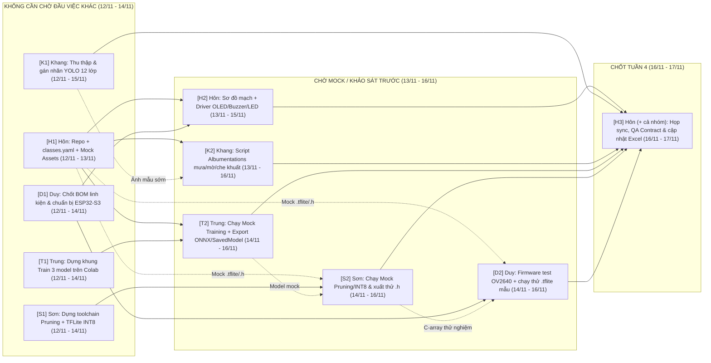

# KẾ HOẠCH THỰC HIỆN ĐỒ ÁN TUẦN 4 (11/11 – 17/11/2026)
## MÔN: TRÍ TUỆ NHÂN TẠO CHO HỆ THỐNG NHÚNG (`CE340`) — ĐỀ TÀI EDGE AI & TINYML

> **Khoảng thời gian:** Thứ Tư `11/11/2026` – Thứ Ba `17/11/2026` *(Tuần 4 — Khởi động Zero-Waiting Pipeline; khung thực thi tập trung `12/11 – 17/11/2026`)*  
> **Tài liệu tham chiếu:** [De_Cuong_Chi_Tiet_Do_An_CE340.md](./De_Cuong_Chi_Tiet_Do_An_CE340.md) | [Khao_Sat_De_Tai_Va_Phuong_An_Thiet_Ke_CE340.md](./Khao_Sat_De_Tai_Va_Phuong_An_Thiet_Ke_CE340.md) | [Ke_Hoach_Thuc_Hien_Do_An_CE340_Nhom_Hon.xlsx](./Ke_Hoach_Thuc_Hien_Do_An_CE340_Nhom_Hon.xlsx) | [README.md](./README.md)  
> **Phạm vi tài liệu:** Chỉ liệt kê các đầu việc **thuộc Đồ án CE340** của 5 thành viên trong Tuần 4 theo bảng phân công đã cập nhật (hoán đổi nhiệm vụ giữa **Vũ Văn Duy** – Nhúng & Thực nghiệm và **Hoàng Cao Sơn** – Tối ưu hóa TinyML). Mỗi đầu việc ghi rõ **Đầu vào (Inputs)**, trạng thái **Chờ người khác hoàn thành**, **Sản phẩm bàn giao** và **lưu ý kỹ thuật**.  
> **Quy ước tái sử dụng mã nguồn & Contract-First:** Các cấu hình (`classes.yaml`), script Python tăng cường ảnh, huấn luyện, nén TinyML và firmware test khởi tạo trong Tuần 4 là nền tảng trực tiếp cho Tuần 5–7 để đảm bảo 5 thành viên chạy song song không nghẽn cổ chai.

---

## I. SƠ ĐỒ PHỤ THUỘC ĐẦU VIỆC (AI LÀM LUÔN – AI CHỜ AI?)

---

## II. MA TRẬN PHỤ THUỘC TỔNG HỢP GIỮA 5 THÀNH VIÊN

| Thành viên | MSSV | Đầu việc làm được NGAY (Không chờ ai) | Đầu việc PHẢI CHỜ người khác | Vai trò mở khóa cho người sau |
| :--- | :---: | :--- | :--- | :--- |
| **Trần Hoàng Hôn** *(Trưởng nhóm / PM, QA & Ngoại vi)* | `26410046` | `[H1]` | • `[H2]` (cần `[H1]` dựng thư mục repo & tham chiếu sơ bộ pinout từ `[D1]` trước tối `13/11`) • `[H3]` (chờ `[H2]`, `[K1]`, `[K2]`, `[T2]`, `[S2]`, `[D2]` vào `16/11–17/11`) | **`[H1]` là nút mở khóa Zero-Waiting của toàn nhóm** — cung cấp `classes.yaml` (12 lớp), cấu trúc 6 thư mục repo và bộ *Mock Assets* trước tối `13/11`. |
| **Nguyễn Duy Khang** *(Kỹ sư Dữ liệu & Tăng cường ảnh)* | `26410055` | `[K1]` | • `[K2]` (viết khung `Albumentations` ngay được; để **chạy test chuẩn Contract** cần `classes.yaml` từ `[H1]` và ít nhất `20–30` ảnh mẫu có nhãn từ `[K1]`) | **`[K1]` & `[K2]` mở khóa** nguồn dữ liệu thật và dữ liệu thời tiết khắc nghiệt cho Tuần 5 của Trung (`Train Baseline`) và Sơn (`Calibration Dataset`). |
| **Phạm Thành Trung** *(Kỹ sư AI — Huấn luyện & Benchmark)* | `26410141` | `[T1]` | • `[T2]` (chờ `[T1]` của chính Trung + bộ ảnh mock từ `[H1]` hoặc subset sớm từ `[K1]`) | **`[T2]` mở khóa** định dạng model trung gian (`ONNX` / `SavedModel` FP32) khớp 12 lớp để Sơn kiểm thử pipeline nén TinyML (`[S2]`). |
| **Hoàng Cao Sơn** *(Kỹ sư Tối ưu hóa TinyML)* | `25730061` | `[S1]` | • `[S2]` (chờ `[S1]` của chính Sơn + model mock từ `[H1]` hoặc `[T2]`, kèm giới hạn RAM/Flash `ESP32-S3` từ `[D1]`) | **`[S2]` mở khóa** file `.tflite` INT8 và mảng C-array `.h` chuẩn kích thước đầu vào để Duy kiểm tra khả năng nạp/suy luận trên `ESP32-S3`. |
| **Vũ Văn Duy** *(Kỹ sư Nhúng & Thực nghiệm)* | `26410031` | `[D1]` | • `[D2]` (chờ `[D1]` của chính Duy + file `.tflite`/`.h` mẫu từ `[H1]`/`[S2]`) | **`[D1]` mở khóa** bảng chân linh kiện (*Pinout*) & giới hạn bộ nhớ khả dụng (`Flash`/`PSRAM`/`Tensor Arena`) cho `[H2]` của Hôn và `[S2]` của Sơn. |

---

## III. KẾ HOẠCH CHI TIẾT TỪNG THÀNH VIÊN (11/11 – 17/11/2026)

### 1. Trần Hoàng Hôn (`26410046`) — Trưởng nhóm / PM, QA & Giao tiếp ngoại vi
*Định mức CE340 Tuần 4: ~3.0 giờ (khởi tạo khung Zero-Waiting, chuẩn hóa hợp đồng dữ liệu/ngoại vi & điều phối sync)*

| Mã CV & Hạn | Đầu việc Đồ án | Đầu vào (Inputs) | Chờ người khác hoàn thành? | Sản phẩm bàn giao (Deliverables) |
| :--- | :--- | :--- | :--- | :--- |
| **`[H1]`** 12/11 – 13/11 *(xong trước tối 13/11)* | Khởi tạo cấu trúc Repo, chốt `classes.yaml` (12 lớp QCVN 41:2019/BGTVT) & chuẩn bị *Mock Assets* kích hoạt Zero-Waiting | • Danh mục 12 biển báo trọng điểm tại Mục I.5 của [De_Cuong_Chi_Tiet_Do_An_CE340.md](./De_Cuong_Chi_Tiet_Do_An_CE340.md#L138-L142) • Danh sách thư viện từ Mục I.6 Đề cương (`ultralytics`, `tensorflow`, `onnx`, `albumentations`, `opencv-python`) | **Không cần chờ ai (Làm ngay).** *Quy ước bắt buộc:* Khóa cứng ID lớp `0..11` trong `classes.yaml` (`P.102`, `P.103a`, `P.103b`, `P.124a`, `P.111a`, `R.301a`, `R.303`, `P.127_40`, `P.127_50`, `P.127_60`, `W.209`, `W.245`) và kích thước ảnh đầu vào thống nhất (`320x320` hoặc `416x416`). | • Khung 6 thư mục trên GitHub: `01_dataset/`, `02_augmentation/`, `03_models_benchmark/`, `04_tinyml_optimization/`, `05_firmware_esp32s3/`, `06_reports_slides/` + `requirements.txt`. • File `01_dataset/classes.yaml` + bộ *Mock Assets* (`15–20` ảnh gán nhãn mẫu chuẩn YOLO + `1` file `.tflite`/`.h` mẫu tối giản). |
| **`[H2]`** 13/11 – 15/11 | Thiết kế sơ đồ đấu nối phần cứng & viết module driver test ngoại vi ghi-đông (`OLED`, `Buzzer`, `LED`) | • Khối Giao Diện Cảnh Báo tại Mục I.1 Đề cương & Mục III của [Khao_Sat_De_Tai_Va_Phuong_An_Thiet_Ke_CE340.md](./Khao_Sat_De_Tai_Va_Phuong_An_Thiet_Ke_CE340.md#L131-L137) • Danh mục linh kiện & chân `GPIO` khả dụng từ `[D1]` | **Chờ `[H1]`** (có thư mục `05_firmware_esp32s3/`) và **chốt nhanh pinout I2C/GPIO với `[D1]`** của Duy (tránh đụng chân camera `OV2640` trên `ESP32-S3-CAM`). | • Sơ đồ đấu nối `05_firmware_esp32s3/wiring_diagram.md` (chỉ rõ chân `SDA/SCL` cho `OLED I2C 0.96"/1.3"`, chân `PWM` cho `Buzzer 5V`, chân `LED` cảnh báo và nguồn `5V`). • Module `05_firmware_esp32s3/peripherals_test/` test hiển thị bitmap icon biển báo + còi bíp ngắn khi nhận `class_id` giả lập (chạy kiểm tra trên Wokwi hoặc mạch thật). |
| **`[H3]`** 16/11 – 17/11 | Điều phối họp sync cuối Tuần 4, kiểm tra chéo (QA) & cập nhật tiến độ | • Toàn bộ sản phẩm `[H2]`, `[K1]`, `[K2]`, `[T2]`, `[S2]`, `[D2]` • [Ke_Hoach_Thuc_Hien_Do_An_CE340_Nhom_Hon.xlsx](./Ke_Hoach_Thuc_Hien_Do_An_CE340_Nhom_Hon.xlsx) | **Chờ tất cả đầu việc Tuần 4 hoàn thành** để kiểm tra khớp *Contract*: ID lớp YOLO ↔ Export ONNX/TFLite ↔ Mảng C-array `.h` ↔ Firmware `ESP32-S3`. | • Biên bản chốt kỹ thuật cuối Tuần 4 tại `06_reports_slides/week4_sync_notes.md`. • Nhánh `main` GitHub hợp nhất sạch code Tuần 4 + cập nhật `%` hoàn thành Tuần 4 trong [Ke_Hoach_Thuc_Hien_Do_An_CE340_Nhom_Hon.xlsx](./Ke_Hoach_Thuc_Hien_Do_An_CE340_Nhom_Hon.xlsx) và [De_Cuong_Chi_Tiet_Do_An_CE340.md](./De_Cuong_Chi_Tiet_Do_An_CE340.md). |

---

### 2. Nguyễn Duy Khang (`26410055`) — Kỹ sư Dữ liệu & Tăng cường ảnh
*Định mức CE340 Tuần 4: ~3.0 giờ | Xây dựng nguồn dữ liệu gốc QCVN 41:2019 và pipeline thời tiết phức tạp*

| Mã CV & Hạn | Đầu việc Đồ án | Đầu vào (Inputs) | Chờ người khác hoàn thành? | Sản phẩm bàn giao (Deliverables) |
| :--- | :--- | :--- | :--- | :--- |
| **`[K1]`** 12/11 – 15/11 | Thu thập, lọc lớp & chuẩn hóa gán nhãn tập dữ liệu biển báo giao thông Việt Nam (12 lớp) | • Nguồn dữ liệu công khai (*Zalo AI Challenge Traffic Sign*, *VNTS*, *Roboflow Universe*) + ảnh/video tự quay đường phố TP.HCM • Bảng `12` lớp chuẩn từ `01_dataset/classes.yaml` (`[H1]`) | **Bắt đầu thu thập & lọc ảnh NGAY; chốt ánh xạ `class_id` theo `classes.yaml` từ `[H1]`** (hoàn thiện trước `13/11`). *Lưu ý kỹ thuật:* Khi chia `Train / Val / Test (70 / 20 / 10)`, **bắt buộc chia theo phiên quay / đoạn đường (group split)** chứ không chia ngẫu nhiên từng frame video liên tiếp để tránh *Data Leakage*. | • Báo cáo thống kê phân bố lớp `01_dataset/dataset_summary.md` + dữ liệu chuẩn hóa định dạng YOLO (`images/`, `labels/*.txt`, `data.yaml`) cho giai đoạn đầu (tối thiểu `500–1.000` ảnh sạch đã gán nhãn chuẩn `12` lớp, hướng tới `3.000–5.000` ảnh sau tăng cường ở Tuần 5). |
| **`[K2]`** 13/11 – 16/11 | Xây dựng & kiểm thử script `Albumentations` tăng cường dữ liệu thời tiết phức tạp | • Yêu cầu kịch bản tại Nội dung 2 & Mục I.5 Đề cương: mưa đọng ống kính, mờ chuyển động (`30–50 km/h`), che khuất một phần ($< 40\%$), thiếu sáng ban đêm • Subset `20–30` ảnh có nhãn từ `[K1]` (hoặc mock `[H1]`) | **Viết script ngay được; chạy test xuất ảnh mẫu sau khi có `classes.yaml` (`[H1]`) và subset ảnh có nhãn (`[K1]`).** *Lưu ý kỹ thuật:* Phải cấu hình `A.BboxParams(format='yolo', label_fields=['class_labels'], min_visibility=0.4)` để không giữ lại bounding box bị cắt mất quá nhiều sau phép biến đổi; kiểm tra trực quan ít nhất `20` ảnh đầu ra xem box có lệch hay không. | • Script `02_augmentation/augment_weather.py` (tích hợp `RandomRain`, `MotionBlur`, `CoarseDropout`, `RandomBrightnessContrast`, `CLAHE` tham khảo). • Thư mục mẫu `02_augmentation/preview_samples/` chứa `20–30` ảnh đã vẽ bounding box kiểm chứng trực quan không lỗi nhãn. |

---

### 3. Phạm Thành Trung (`26410141`) — Kỹ sư AI (Huấn luyện & Benchmark)
*Định mức CE340 Tuần 4: ~2.5 giờ | Dựng sẵn khung train 3 kiến trúc nhẹ & pipeline đo benchmark trước khi có full dataset*

| Mã CV & Hạn | Đầu việc Đồ án | Đầu vào (Inputs) | Chờ người khác hoàn thành? | Sản phẩm bàn giao (Deliverables) |
| :--- | :--- | :--- | :--- | :--- |
| **`[T1]`** 12/11 – 14/11 | Thiết lập môi trường GPU & dựng khung huấn luyện 3 kiến trúc nhẹ (`YOLOv8n`, `YOLOv5-tiny`, `MobileNetV2-SSD`) | • Danh sách 3 mô hình mục tiêu tại Nội dung 3 của [De_Cuong_Chi_Tiet_Do_An_CE340.md](./De_Cuong_Chi_Tiet_Do_An_CE340.md#L122-L125) • Yêu cầu input nhỏ gọn cho Edge AI (`320x320` hoặc `416x416`) | **Không cần chờ ai (Làm ngay).** *Lưu ý kỹ thuật:* Thống nhất phiên bản `ultralytics` / `torch` / `tensorflow` với Sơn (`[S1]`) ngay trong file `requirements.txt` để tránh xung đột khi chuyển sang `ONNX` / `TFLite`. | • Cấu hình & script khung `03_models_benchmark/train_baseline.py` (hoặc notebook chuẩn hóa có tham số CLI/config cho `YOLOv8n`, `YOLOv5-tiny`, `MobileNetV2-SSD`). |
| **`[T2]`** 14/11 – 16/11 | Chạy thử **Mock Training Pipeline**, chuẩn hóa hàm Benchmark & kiểm tra luồng Export sang định dạng cho TinyML | • Khung code từ `[T1]` • Bộ *Mock Assets* (`[H1]`) hoặc subset sớm (`[K1]`) | **Chờ `[T1]` của chính Trung + bộ *Mock Assets* từ `[H1]`** (xong trước tối `13/11`). *Lưu ý kỹ thuật:* Phải chạy thông từ bước train `2–5 epochs` (smoke-test) đến xuất đủ `Precision`, `Recall`, `F1-Score`, `mAP@0.5`, `Confusion Matrix` và **export thử file `.onnx` / `SavedModel` (FP32)** không báo lỗi toán tử (*unsupported ops*) cho Sơn. | • Script `03_models_benchmark/evaluate_benchmark.py` xuất bảng CSV/Markdown chuẩn hóa. • `1` file model mock FP32 (`.pt` + `.onnx` / `SavedModel`) + log chạy thử smoke-test lưu tại `03_models_benchmark/mock_outputs/` để Sơn dùng chạy `[S2]`. |

---

### 4. Hoàng Cao Sơn (`25730061`) — Kỹ sư Tối ưu hóa (TinyML)
*Định mức CE340 Tuần 4: ~2.5–3.0 giờ | Mới nhận chuyển giao vai trò TinyML: thiết lập toolchain Pruning + INT8 Quantization & xuất thử C-array*

| Mã CV & Hạn | Đầu việc Đồ án | Đầu vào (Inputs) | Chờ người khác hoàn thành? | Sản phẩm bàn giao (Deliverables) |
| :--- | :--- | :--- | :--- | :--- |
| **`[S1]`** 12/11 – 14/11 | Nghiên cứu & thiết lập toolchain nén TinyML (`Pruning` + `Post-Training Quantization INT8`) tương thích `ESP32-S3` | • Nội dung 4 & Mục I.6 Đề cương (`TensorFlow Lite Converter`, `TFLM`, `ONNX Runtime`) • Thông số giới hạn Flash/PSRAM và tập toán tử hỗ trợ trên `ESP32-S3` từ `[D1]` | **Không cần chờ ai để dựng môi trường Python (`tensorflow`, `onnx`, `onnx2tf`, `tensorflow-model-optimization`); đối chiếu giới hạn bộ nhớ kit với `[D1]` của Duy.** *Lưu ý kỹ thuật:* Kiểm tra kỹ danh sách toán tử (*ops*) được `tflite-micro` trên `ESP32-S3` hỗ trợ (tránh dùng các layer giải mã phức tạp của YOLO không có kernel INT8 trên TFLM). | • Tài liệu ghi chú tương thích `04_tinyml_optimization/tinyml_toolchain_notes.md` (so sánh luồng chuyển đổi `PyTorch -> ONNX -> TFLite INT8` và `TF/Keras -> TFLite INT8`, danh sách ops hợp lệ & giới hạn kích thước model mục tiêu $< 2\text{–}4\text{ MB}$). |
| **`[S2]`** 14/11 – 16/11 | Dựng **Mock Optimization Pipeline**: chạy thử `Pruning` + `INT8 Quantization` & xuất mảng C-array `.h` | • Toolchain từ `[S1]` • Model FP32 mock từ `[T2]` (hoặc model mẫu từ `[H1]`) + `10–20` ảnh hiệu chuẩn (*Representative Calibration Dataset*) | **Chờ `[S1]` của chính Sơn + model mock từ `[H1]` hoặc `[T2]`.** *Lưu ý kỹ thuật:* Bắt buộc dùng **Full Integer Quantization (`INT8` cả weights, activations và input/output)** với `representative_dataset` để chạy tối ưu trên TFLM; kiểm tra tỷ lệ giảm dung lượng ($\ge 70\%$ so với FP32) và xuất thử mảng C-array `.h` (`xxd -i` hoặc script Python). | • Script `04_tinyml_optimization/quantize_int8_mock.py` (tạo `.tflite` INT8 + báo cáo kích thước FP32 vs INT8). • File C-array mẫu `04_tinyml_optimization/mock_model_int8.h` bàn giao sang `[D2]` để Duy kiểm tra biên dịch/nạp trên `ESP32-S3`. |

---

### 5. Vũ Văn Duy (`26410031`) — Kỹ sư Nhúng & Thực nghiệm
*Định mức CE340 Tuần 4: ~2.5–3.0 giờ | Mới nhận chuyển giao vai trò Nhúng: chốt phần cứng ESP32-S3-CAM & dựng firmware test camera + TFLM*

| Mã CV & Hạn | Đầu việc Đồ án | Đầu vào (Inputs) | Chờ người khác hoàn thành? | Sản phẩm bàn giao (Deliverables) |
| :--- | :--- | :--- | :--- | :--- |
| **`[D1]`** 12/11 – 14/11 | Khảo sát, chốt danh mục linh kiện (**BOM**), lên phương án hộp gắn ghi-đông & đặt chuẩn bị kit thật | • Kiến trúc phần cứng tại Mục I.6 Đề cương & Mục III của [Khao_Sat_De_Tai_Va_Phuong_An_Thiet_Ke_CE340.md](./Khao_Sat_De_Tai_Va_Phuong_An_Thiet_Ke_CE340.md#L112-L138) (`ESP32-S3-CAM`, `OV2640`, `OLED I2C`, `Buzzer 5V`, `LED`, nguồn `5V` USB/sạc dự phòng) | **Không cần chờ ai (Làm ngay).** *Lưu ý kỹ thuật:* Bắt buộc chọn bản **`ESP32-S3-WROOM-1 N16R8`** (Flash `16MB` + **PSRAM `8MB` Octal**), vì bản không có PSRAM sẽ không đủ bộ nhớ cấp phát *Tensor Arena* cho model nhận diện ảnh; thống nhất pinout sớm với `[H2]` của Hôn. | • File `05_firmware_esp32s3/bom_and_hardware_specs.md` gồm: bảng linh kiện (BOM), ước tính chi phí, sơ đồ chân (*Pinout*) `ESP32-S3-CAM N16R8`, dung lượng Flash/PSRAM khả dụng và phương án gá đặt hộp bảo vệ chống rung lên ghi-đông xe máy. |
| **`[D2]`** 14/11 – 16/11 | Cài đặt IDE nhúng & dựng **Mock Firmware** test camera `OV2640` + chạy thử suy luận `.tflite` / `.h` mẫu | • Thông số chân & bộ nhớ từ `[D1]` • File `.tflite`/`.h` mẫu từ `[H1]` (hoặc `mock_model_int8.h` từ `[S2]`) | **Chờ `[D1]` của chính Duy + file model mẫu `.h` từ `[H1]`/`[S2]`.** *Lưu ý kỹ thuật:* Cấu hình đúng flag bật **OPI PSRAM** trong `Arduino IDE` / `PlatformIO` / `ESP-IDF`; kiểm tra kích thước tối đa của `kTensorArenaSize` cấp phát được trong PSRAM để phản hồi ngay cho Sơn (`[S1]`, `[S2]`) trước khi train model thật ở Tuần 5. | • Project `05_firmware_esp32s3/mock_inference_test/` biên dịch sạch (không lỗi thiếu thư viện/tràn RAM): khởi tạo được cấu trúc đọc frame `OV2640` (`320x320` / `RGB565` hoặc `RGB888`) và nạp chạy thử `tflite-micro` với model mẫu, ghi nhận log chiếm dụng Flash/RAM/PSRAM dự kiến. |

---

## IV. CHECKLIST NGHIỆM THU TUẦN 4 (`DEFINITION OF DONE` — HẠN `17/11/2026`)

- [ ] **Repo & Data Contract (`[H1]`, `[H2]`):** Đủ 6 thư mục chuẩn trên GitHub; file `01_dataset/classes.yaml` khóa đúng `12` lớp biển báo QCVN 41:2019/BGTVT; hoàn thiện `wiring_diagram.md` và driver test ngoại vi `OLED` / `Buzzer` / `LED` không trùng chân `OV2640`.
- [ ] **Dataset & Weather Augmentation (`[K1]`, `[K2]`):** Có dữ liệu ảnh sạch gán nhãn YOLO đúng ID trong `classes.yaml` (chia `70/20/10` theo nhóm chống leak frame); script `augment_weather.py` chạy thông các kịch bản mưa, mờ chuyển động, che khuất $<40\%$, thiếu sáng và kiểm chứng trực quan `20–30` ảnh mẫu không lệch bounding box.
- [ ] **Mock Training & Benchmark (`[T1]`, `[T2]`):** Khung code 3 mô hình (`YOLOv8n`, `YOLOv5-tiny`, `MobileNetV2-SSD`) chạy smoke-test thành công, xuất được bảng chỉ số (`Precision`, `Recall`, `F1-Score`, `mAP@0.5`) và export sạch model FP32 (`.onnx` / `SavedModel`) làm đầu vào cho luồng TinyML.
- [ ] **Mock TinyML Optimization (`[S1]`, `[S2]`):** Pipeline `Pruning` + `Full Integer Quantization INT8` chạy thông trên model mẫu, xác nhận tỷ lệ nén $\ge 70\%$ và xuất được file `.tflite` INT8 + C-array `.h` tương thích toán tử `tflite-micro`.
- [ ] **BOM Phần cứng & Mock Firmware (`[D1]`, `[D2]`):** Chốt BOM mua/chuẩn bị kit `ESP32-S3-CAM N16R8` (có PSRAM `8MB`), `OLED I2C`, `Buzzer 5V`, nguồn `5V` & phương án hộp ghi-đông; firmware mock biên dịch thành công, đo/ước lượng được giới hạn `Flash` & `PSRAM Tensor Arena`.
- [ ] **Đồng bộ cuối tuần (`[H3]`):** Cả 5 thành viên họp sync vào `16/11–17/11`, rà soát chéo toàn bộ *Contract*, hợp nhất sản phẩm lên nhánh `main` GitHub và cập nhật `%` Tuần 4 trong [Ke_Hoach_Thuc_Hien_Do_An_CE340_Nhom_Hon.xlsx](./Ke_Hoach_Thuc_Hien_Do_An_CE340_Nhom_Hon.xlsx).

